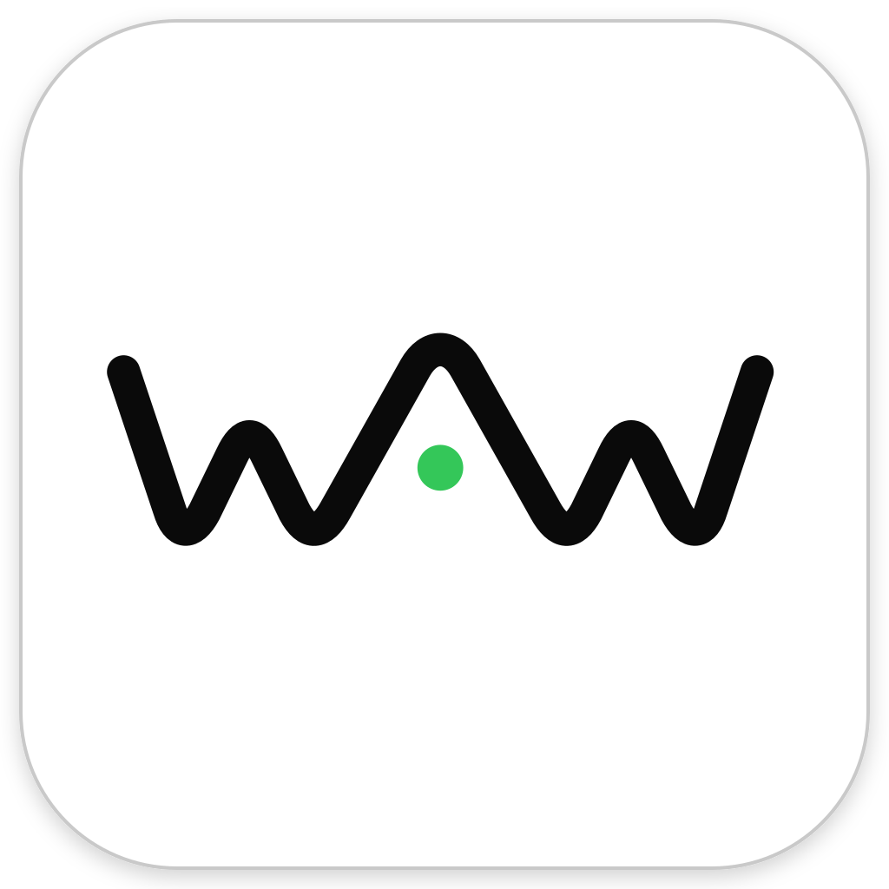

<div align="center">
  <br />
  
  <h2>Work Anywhere (WAW)</h2>
  <p><strong>English</strong> | <a href="README.md">简体中文</a></p>
</div>

Work Anywhere (WAW) aims to let you interact with ChatGPT Codex Desktop on your computer in real time from your phone, so you can monitor and control running tasks or issue new instructions whenever you are away from your computer.

Who is it for?

- People who prefer the official ChatGPT Codex Desktop but either do not have a ChatGPT account or have an account but frequently cannot connect to the official Remote feature because of network issues.
- People who need to monitor ChatGPT Codex tasks on their computer from a phone and dispatch new tasks while away.

The official ChatGPT Codex Desktop remains the only desktop presentation layer; this project does not introduce a separate desktop chat UI.

The complete product is organized into three independent modules:

- `desktop`: integrates with the official ChatGPT Codex Desktop, supervises official Codex App Server processes, and exposes local control capabilities.
- `relay`: relays encrypted connections, task state, and notifications between Desktop daemons and mobile clients.
- `mobile`: displays task progress, handles approvals and questions, and continues conversations; the Android-first Flutter/Go Core, pairing flow, and workspace are established but remain pre-release.

**Desktop V1 and the single-node Relay V1 are implemented.** Desktop includes the outbound Relay connector, device enrollment, scannable QR pairing, Noise end-to-end encryption, and the Mobile control adapter. Relay can be deployed with Docker Compose and PostgreSQL. Mobile now has an Android-first Flutter app, Go endpoint core, Pigeon/Keystore host, and tester-APK CI; its conversation composer supports per-thread plan mode, model, reasoning-effort, and four execution-permission choices. Physical-device, iOS, push, complete action DTO, and release validation remain incomplete. The browser Mobile simulator is still only for protocol development.

Mobile conversation sync uses a metadata snapshot, a recent 20-item timeline page, and incremental recovery. Older history is loaded with opaque cursors, while individual content blocks over 64 KiB are available on demand through temporary chunked references. Desktop control responses are capped at 512 KiB and Relay keeps its 1 MiB routed-payload limit.

## Current capabilities

Desktop V1 provides:

- Integration with the official ChatGPT Codex Desktop through `CODEX_CLI_PATH` without replacing the official UI.
- Automatic discovery of the official `codex.exe` used by Desktop, with runtime upgrades switched at a safe boundary.
- One daemon per Windows user and one supervised official App Server per logical Codex instance.
- Multiple ChatGPT Desktop instances, isolated by Windows SID, `CODEX_HOME`, Electron user-data, and an optional instance name.
- Instance, conversation, Turn-state, and incremental-event observation.
- Local control for starting text/image Turns and selecting a model, reasoning effort, approval policy, and sandbox policy.
- Mid-run approval handling, user-question responses, and Turn interruption.
- Continued App Server ownership after a Desktop Bridge disconnects, with initialize state restored when Desktop reconnects.
- SQLite conversation projections, attachment storage, structured logs, and explicitly enabled full-protocol traffic diagnostics.
- A system tray, local administration page, and command-line control interface.
- Pre-request fallback to the official Codex executable when the daemon cannot be reached, prioritizing Desktop availability.

Relay V1 provides:

- Ed25519 device authentication, one-time daemon enrollment, explicit QR pairing, and per-edge scopes.
- Single-node online ciphertext routing, Noise KK end-to-end encryption, and the Desktop remote-control loop.
- Minimal PostgreSQL persistence, River push jobs, APNs/FCM adapters, health checks, and Prometheus metrics.
- A Linux container and local Docker Compose deployment; the browser Mobile simulator performs real pairing and encrypted control calls.

## Architecture

```text
ChatGPT Desktop A ─► Bridge A ─┐
                               │  per-user protected Named Pipe
ChatGPT Desktop B ─► Bridge B ─┼──────────────────────────────┐
                               │                              ▼
Local CLI / Admin page ────────┘                       Desktop daemon
                                                             │
                                      ┌──────────────────────┼─────────────────────┐
                                      ▼                      ▼                     ▼
                              Codex App Server A      Codex App Server B      Encrypted SQLite
                                      │                      │
                                      └──── official Codex sessions ────┘

Mobile / dev simulator ◄════ Noise E2EE over WSS ════► Relay ◄════ outbound WSS ════► daemon
```

`work-anywhere.exe` is a single binary with multiple modes:

```text
work-anywhere.exe app-server ...   Transparent Bridge invoked by ChatGPT Desktop
work-anywhere.exe daemon run       Resident daemon
work-anywhere.exe <command>        Local control CLI
other Codex arguments              Passed through to the real codex.exe
```

The production path uses the official App Server stdio JSONL transport. If Desktop prepends global options such as `-c key=value` before the `app-server` subcommand, the Bridge still recognizes and preserves them. Bridge and daemon communicate through the versioned, length-prefixed WAI1 Named Pipe protocol. The daemon owns JSON-RPC ID isolation, initialize virtualization, approval arbitration, App Server lifecycle, and the local control API.

## Repository layout

```text
work-anywhere/
├─ AGENTS.md                    Development and documentation rules
├─ go.work                      Go workspace
├─ relay/
│  ├─ cmd/relay/                Relay service, migrations, and enrollment CLI
│  ├─ cmd/mobile-simulator/     Browser Mobile simulator for development only
│  ├─ internal/                 Identity, pairing, routing, push, store, and observability
│  ├─ proto/                    Owner of the Relay V1 Protobuf protocol
│  ├─ migrations/               PostgreSQL and River migrations
│  ├─ Dockerfile                Linux container image
│  ├─ compose.yaml              Single-node local deployment
│  ├─ README.md                 Relay build, deployment, and integration entrypoint
│  └─ docs/                     Current Relay design and remaining hardening work
├─ desktop/
│  ├─ cmd/work-anywhere/        Single-binary entry point
│  ├─ internal/
│  │  ├─ bridge/                Desktop stdio Bridge
│  │  ├─ daemon/                App Server supervisor and control plane
│  │  ├─ codex/                 Codex runtime, instance, and argument handling
│  │  ├─ jsonrpc/               JSON-RPC envelopes and IDs
│  │  ├─ provider/              Extensible Provider interface
│  │  ├─ store/                 Encrypted SQLite projection
│  │  └─ platform/              Windows/macOS/Linux platform boundary
│  ├─ packaging/                Platform installation, signing, and release assets
│  ├─ docs/                     Current-state design documentation
│  ├─ scripts/                  Build scripts
│  └─ testdata/                 Official App Server schema fixtures
└─ mobile/
   ├─ README.md                 Product scope, architecture, and delivery entrypoint
   ├─ core/                     gomobile endpoint facade
   ├─ app/                      Flutter, Pigeon, and Android/iOS hosts
   ├─ scripts/                  Toolchain, test, generation, and Android build entrypoints
   └─ docs/                     Architecture, sync, interaction, and delivery designs
```

Shared Bridge and daemon business logic is not copied per operating system. OS-specific behavior lives under `desktop/internal/platform/`, while release configuration lives under `desktop/packaging/<platform>/`. Windows x64 is the only runnable target today. macOS and Linux currently provide cross-compilable adapter skeletons only; see the [platform support design](desktop/docs/platform-support/design.md).

## Installation and deployment

The Windows Desktop installation follows. For Docker/PostgreSQL Relay deployment, Desktop pairing, and Mobile integration, see [`relay/README.md`](relay/README.md); for Mobile build and verification, see [`mobile/README.md`](mobile/README.md).

### Requirements

- Windows x64.
- A working installation of the official ChatGPT Codex Desktop.
- Go is not required when using an existing binary. Building from source requires the Go 1.26.5 Windows x64 SDK.
- The current user must be able to write to `%LOCALAPPDATA%\WorkAnywhere`.

### 1. Obtain or build the executable

When a repository build is already available, use:

```text
desktop\dist\windows-amd64\work-anywhere.exe
```

To build from source:

```powershell
cd D:\CodeSpace\work-anywhere\desktop
.\scripts\build.ps1
```

The build script uses the pinned Go 1.26.5 toolchain under `desktop\.tools\go-sdk\go`, runs the tests, and produces a single Windows x64 executable.

To create a distributable Windows installer, install Inno Setup 6 and run:

```powershell
cd D:\CodeSpace\work-anywhere\desktop
.\scripts\build-installer.ps1 -Version 0.1.0
```

The installer is written to `desktop\dist\windows-amd64\work-anywhere-setup-0.1.0.exe`. It uses a per-user installation with no administrator privileges, installs under `%LOCALAPPDATA%\Programs\WorkAnywhere`, sets the current user's `CODEX_CLI_PATH`, backs up the previous value, and prompts you to fully exit and restart every ChatGPT Desktop instance after setup. Uninstallation attempts to stop the daemon and restore the previous environment variable, but leaves session and configuration data under `%LOCALAPPDATA%\WorkAnywhere` intact.

### 2. Run pre-installation checks

```powershell
cd D:\CodeSpace\work-anywhere\desktop
.\dist\windows-amd64\work-anywhere.exe version
.\dist\windows-amd64\work-anywhere.exe self-test
```

`self-test` should report `"ok": true` and show the discovered official Codex path, version, SHA256, `CODEX_HOME`, and user-data directory. If the official executable cannot be found, override it for the current environment:

```powershell
$env:WORK_ANYWHERE_CODEX_EXE = 'C:\path\to\ChatGPT\resources\codex.exe'
.\dist\windows-amd64\work-anywhere.exe self-test
```

### 3. Integrate with ChatGPT Desktop

```powershell
.\dist\windows-amd64\work-anywhere.exe install
```

The installer command:

1. Backs up the current user-level `CODEX_CLI_PATH`.
2. Points the user-level `CODEX_CLI_PATH` to this executable.
3. Broadcasts a Windows environment change notification.

Fully restart every ChatGPT Desktop instance after installation so each process inherits the new environment. Multiple Desktop instances can share one `work-anywhere.exe`; the daemon separates them by `CODEX_HOME` and user-data.

When different Desktop profiles are launched through external scripts, you may also set:

```powershell
$env:CODEX_HOME = 'C:\Users\me\.codex-work'
$env:WORK_ANYWHERE_USER_DATA_DIR = 'C:\Users\me\AppData\Local\OpenAI\CodexProfiles\work'
$env:WORK_ANYWHERE_INSTANCE_NAME = 'work'
```

### 4. Verify the running installation

After opening ChatGPT Desktop:

```powershell
$wa = 'D:\CodeSpace\work-anywhere\desktop\dist\windows-amd64\work-anywhere.exe'
& $wa daemon status
& $wa instance list
& $wa ui
```

The daemon starts on demand. It does not configure Windows login startup and does not exit automatically when Desktop closes or becomes idle. `ui` opens a local administration page bound only to `127.0.0.1`.

### Relay and Mobile integration

After installing Desktop, use Relay and the Android-first Mobile test client to verify the remote path:

```powershell
cd D:\CodeSpace\work-anywhere\relay
Copy-Item .env.example .env
# Generate RELAY_DATA_KEY as described in relay/README.md, then start Relay.
docker compose up --build -d
docker compose exec relay /relay enrollment create --ttl 24h --uses 1
```

Configure the Relay origin in the Desktop administration page, generate a pairing QR code, scan it in the Mobile app, and approve the pending pairing from Desktop. See [`relay/README.md`](relay/README.md) and [`mobile/README.md`](mobile/README.md) for the full commands, device-network requirements, and troubleshooting. Mobile is still a test client and is not ready for production release.

## Usage

The following examples assume:

```powershell
$wa = 'D:\CodeSpace\work-anywhere\desktop\dist\windows-amd64\work-anywhere.exe'
```

### Daemon and instances

```powershell
& $wa daemon start
& $wa daemon status
& $wa instance list
& $wa instance get <instance-id>
& $wa instance restart <instance-id>
```

### Conversations and Turns

```powershell
& $wa conversation list <instance-id>
& $wa conversation read <instance-id> <thread-id>
& $wa turn start <instance-id> <thread-id> 'Continue the current task'
& $wa turn interrupt <instance-id> <thread-id> <turn-id>
```

A local control client may start a new Turn only while the conversation is idle. Original requests from Desktop remain transparent and the official App Server decides whether they conflict with concurrent work.

### Approvals and questions

```powershell
& $wa action list <instance-id>
& $wa action resolve <instance-id> <request-id> '<json-result>'
```

`json-result` must follow the official response shape for the corresponding action. Desktop and local control clients may receive an action simultaneously, but only the first valid resolution is sent to App Server. Later responses return `already_resolved`.

### Models, permissions, and diagnostics

```powershell
& $wa catalog models <instance-id>
& $wa catalog permissions <instance-id>
& $wa traffic on <instance-id>
& $wa traffic off <instance-id>
& $wa call <control-method> '<json-params>'
```

Full protocol traffic is disabled by default because it can contain prompts, tool output, file content, and credentials. Enable it only for short-lived diagnostics and disable it immediately afterward.

## Data and security

Runtime data is stored under:

```text
%LOCALAPPDATA%\WorkAnywhere
```

- Instance, conversation, Turn, Timeline, pending-action, attachment, and settings projections are stored in SQLite WAL.
- Message bodies, tool payloads, diffs, actions, and attachment content are encrypted with AES-256-GCM.
- The AES master key is protected by current-user Windows DPAPI.
- The Bridge/daemon Named Pipe is protected by a current-user SID ACL.
- The administration page binds to a random loopback port and uses a one-time token, SameSite session, Origin checks, and CSRF protection.
- Full process environments are not persisted, and complete JSONL traffic is not recorded by default.
- Official Codex session files remain the authoritative source for complete conversations. The Work Anywhere database is a control-plane projection and must not overwrite official sessions if damaged.

## Stopping and uninstalling

Stop the daemon normally:

```powershell
& $wa daemon stop
```

Normal shutdown is rejected while a Turn is active. To explicitly interrupt active work, use the tray confirmation or:

```powershell
& $wa daemon force-stop
```

Uninstall the Bridge:

```powershell
& $wa uninstall
```

Uninstall restores the user-level `CODEX_CLI_PATH` backed up during installation. Fully restart ChatGPT Desktop afterward.

## Troubleshooting

### The official codex.exe cannot be found

Run `self-test` first and set `WORK_ANYWHERE_CODEX_EXE` if necessary. See [runtime and instance design](desktop/docs/runtime-and-instance/design.md) for discovery order and multi-instance identity rules.

### The daemon is not running

```powershell
& $wa daemon start
& $wa daemon status
```

Structured logs are stored under `%LOCALAPPDATA%\WorkAnywhere\logs`.

### A conversation reports an active writer

One official session cannot be owned by two independent App Server writers simultaneously. Only instances created or connected through this Bridge can be fully controlled by the daemon. Work Anywhere does not forcibly take over sessions already owned by another Codex process.

### Desktop behaves unexpectedly after an upgrade

Run `self-test` again and inspect the discovered path and version. Idle instances switch to a new runtime immediately; active Turns switch at a safe boundary. If the official application removes or changes `CODEX_CLI_PATH`, the Desktop integration layer will need to be updated.

## Development and verification

```powershell
cd D:\CodeSpace\work-anywhere\desktop
.\.tools\go-sdk\go\bin\go.exe test ./...
.\.tools\go-sdk\go\bin\go.exe vet ./...
.\scripts\build.ps1
.\dist\windows-amd64\work-anywhere.exe self-test
```

See [`AGENTS.md`](AGENTS.md) for repository development rules, [`desktop/docs/README.md`](desktop/docs/README.md) for current Desktop design documentation, and [`mobile/docs/README.md`](mobile/docs/README.md) for the production Mobile plan. Functional changes must update every affected design document in the same change. Design documents describe only the current state and are not changelogs.

## Current limitations

- Runtime support is limited to Windows x64.
- Mobile has not completed physical-device and production release validation. The browser Mobile simulator is a protocol-development tool, not a production client.
- Relay includes APNs/FCM providers and River jobs, but live Apple sandbox/FCM project verification requires operator credentials.
- Relay V1 is single-node and online-only; it does not provide offline commands, multi-node routing, or Work Anywhere user accounts.
- Codex is the only Provider. Claude Code, OpenCode, Hermes, Pi, and other drivers are not implemented.
- `CODEX_CLI_PATH` is the currently available Desktop integration point, but it is not guaranteed to remain compatible forever.
- Experimental WebSocket transport is available only through `app-server --standalone-ws` diagnostics. The production daemon path always uses stdio.
- `desktop/codex-stdio-ws-bridge` is the previous C# rollback implementation and is not part of the current Go build.
