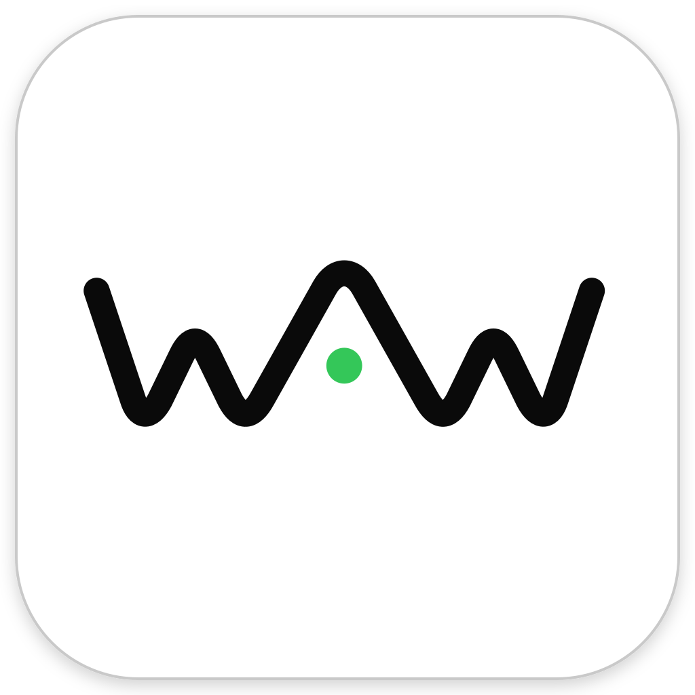
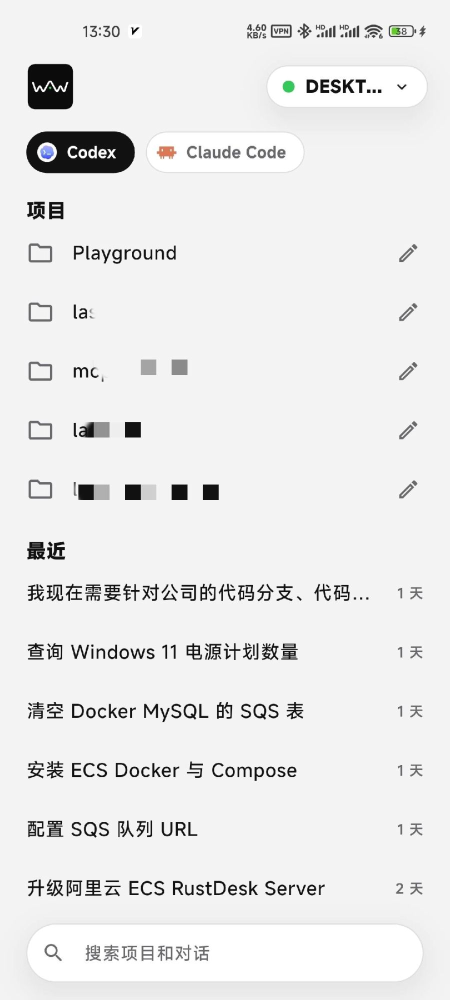
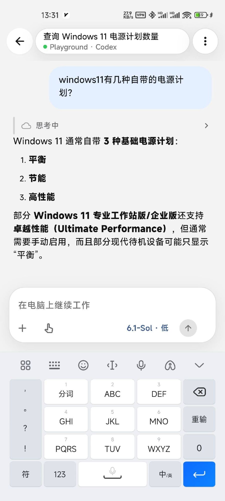

<div align="center">
  <br />
  
  <h2>Work Anywhere(WAW)</h2>
  <p><strong>简体中文</strong> | <a href="README.en.md">English</a></p>
</div>

Work Anywhere（WAW）让你在手机上管理电脑端的官方 ChatGPT Codex Desktop：查看任务进度、继续会话、在已有项目中新建对话，以及处理审批和问题，离开电脑也能继续推进工作。

**Windows Desktop → Relay → Android 的主要远程控制功能已实现。** 电脑端继续使用官方 Codex Desktop，WAW 提供本机 Bridge、加密中继和手机工作台。无需注册 WAW 账号；Codex 的认证和服务访问仍由官方 Desktop 的配置决定。

## 界面预览

<table>
  <tr>
    <td align="center" width="50%"></td>
    <td align="center" width="50%"></td>
  </tr>
  <tr>
    <td valign="top"><strong>首页工作台</strong>：右上角切换已配对的电脑并显示在线状态；顶部在 Codex 和 Claude Code 之间切换；“项目”列出电脑上的工作目录，可直接进入或重命名；“最近”按时间展示会话；底部搜索框同时检索项目和对话。</td>
    <td valign="top"><strong>会话页</strong>：标题栏显示会话名、所属项目、Agent 和电脑在线状态；时间线实时展示用户消息、可展开的思考过程和 Markdown 渲染的回复；输入框支持添加图片、选择模型与思考等级，发送后由电脑上的 Agent 继续执行。</td>
  </tr>
</table>

## 模块状态

| 模块 | 已实现能力 | 当前状态 |
| --- | --- | --- |
| [Desktop](desktop/README.md) | 官方 App Server 托管、多实例、本机管理页与托盘、远程控制、二维码配对 | 支持 Windows x64 |
| [Relay](relay/README.md) | 设备认证、邀请/自助注册、配对、密文路由、PostgreSQL 持久化 | 单节点 V1 已实现，可通过 Docker Compose 部署 |
| [Mobile](mobile/README.md) | 多电脑工作台、项目与会话、实时时间线、文字/图片输入、问题与审批、消息排队 | Android 实现和测试 APK 构建已提供，发布验收尚未完成 |

## 快速上手

1. 安装或构建 Desktop；使用 Codex 时执行 `self-test`、`install` 后完全重启 Codex Desktop，只使用 Claude Code 时可跳过，详见[安装部署](#安装部署)。
2. 使用 Docker Compose 和 PostgreSQL 部署 Relay，配置手机可访问的地址；公网部署建议使用 HTTPS，详见 [Relay 指南](relay/README.md)。
3. 执行 `work-anywhere.exe ui` 打开电脑管理页，填写 Relay 地址并启用远程访问。Relay 默认 `self_service` 模式自动签名注册，无需邀请码；部署者可显式设置 `ENROLLMENT_MODE=invite` 改为邀请码登记。
4. 构建 [Android 测试应用](mobile/README.md#build-and-verification)，扫描电脑端配对二维码，再在电脑上批准手机。
5. 在手机上选择电脑和项目，查看任务、继续会话或新建对话。

## 当前能力

Desktop V1 提供：

- 使用 `CODEX_CLI_PATH` 接入官方 ChatGPT Codex Desktop，不替换官方 UI。
- 自动发现 Desktop 当前使用的官方 `codex.exe`，升级后按安全边界切换新 runtime。
- 一个 Windows 用户运行一个 daemon，每个 Codex 逻辑实例托管一个官方 App Server。
- 支持多个 ChatGPT Desktop 实例，按 Windows SID、`CODEX_HOME`、Electron user-data 和可选实例名隔离。
- 观察实例、会话、Turn 状态和增量事件。
- 从本机控制面发起文字/图片 Turn、指定模型、思考等级、审批和 sandbox 策略。
- 处理中途审批、用户问题和 Turn 中断。
- Desktop Bridge 断开后 daemon 继续持有 App Server；Desktop 重新连接时恢复初始化状态。
- 有界内存会话投影、DPAPI 保护的 JSON 配置、临时附件、结构化日志和显式开启的完整协议流量诊断。
- App Server delta 在加密前按语义批量合并，Mobile 按 `syncEpoch + sequence` 实时展示；缺口、终态或内存超限时回到权威快照。
- 系统托盘、本机管理页和命令行控制工具。
- daemon 无法在请求前建立连接时直通官方 Codex，优先保证 Desktop 可用。
- 接入本机 Claude Code：按项目浏览会话和完整历史，新建会话、发送文字/图片、实时查看回复，处理工具审批、提问和计划确认，中断 Turn，选择模型、思考等级和权限模式；电脑端正在使用的会话只读，见 [Claude Code provider 设计](desktop/docs/claude-code-provider/design.md)。

Relay V1 提供：

- Ed25519 设备认证、邀请或签名自助注册、显式二维码配对和逐边 scope。
- 单节点在线密文路由、Noise KK 端到端加密和 Desktop remote control 闭环。
- PostgreSQL 最小持久化、River push job、APNs/FCM adapters、健康检查和 Prometheus 指标。
- Linux container 与本机 Docker Compose 部署；开发浏览器 Mobile simulator 可完成真实配对和加密调用。

Android Mobile 提供：

- 多电脑扫码配对与切换，以及排序、启用/禁用、名称和 Relay 地址管理。
- 项目与会话浏览、搜索、实时增量更新、历史分页和大内容按需读取。
- 在已有 Codex 项目中新建对话、发送文字/图片和中断 Turn。
- 按会话选择计划模式、模型、思考等级和执行权限。
- 在 Turn 运行中继续输入，并按 provider 支持编辑、立即引导或取消排队消息。
- 多问题回答弹窗、待处理提醒和命令审批的允许/拒绝操作。
- 中英文界面，以及 Android Keystore 保护的配对凭据存储。

Mobile 发送前同步 Desktop 权威状态，版本冲突时保留草稿。iOS、手机推送、完整 approval DTO、应用锁和生产发布验收尚未完成，详见 [Mobile 指南](mobile/README.md)。

升级这些模块时遵循 **Relay → Desktop → Mobile** 顺序，以支持默认配对权限中的 `conversation.create`；已有配对无需重建。图片选择上限为 48 MiB，完整请求经 base64 和 JSON 编码后仍须小于等于 64 MiB；超限保留草稿并提示减少内容。

## 总体架构

```text
ChatGPT Desktop A ─► Bridge A ─┐
                               │  per-user protected Named Pipe
ChatGPT Desktop B ─► Bridge B ─┼──────────────────────────────┐
                               │                              ▼
Local CLI / Admin page ────────┘                       Desktop daemon
                                                             │
                                      ┌──────────────────────┼─────────────────────┐
                                      ▼                      ▼                     ▼
                              Codex App Server A      Codex App Server B      Bounded memory + JSON config
                                      │                      │
                                      └──── official Codex sessions ────┘

Mobile / dev simulator ◄════ Noise E2EE over WSS ════► Relay ◄════ outbound WSS ════► daemon
```

`work-anywhere.exe` 是一个多模式单文件程序：

```text
work-anywhere.exe app-server ...   ChatGPT Desktop 调用的透明 Bridge
work-anywhere.exe daemon run       常驻 daemon
work-anywhere.exe <command>        本机控制 CLI
其他 Codex 参数                    透传给真实 codex.exe
```

正式长驻链路使用官方 App Server 的 stdio JSONL。`app-server --print-startup-config`（含 `--startup-sign-out`）、帮助、schema、daemon/proxy 和非 stdio transport 原样透传官方 CLI，不接入 WAW daemon；未知命令形态也透传，由官方校验。官方 Desktop 在 `app-server` 前附加 `-c key=value` 等全局参数时，Bridge 仍能正确识别并保留这些参数。Bridge 与 daemon 之间使用带版本和长度前缀的 WAI1 Named Pipe 协议；daemon 负责 JSON-RPC ID 隔离、初始化虚拟化、审批仲裁、App Server 生命周期和本机控制 API。

## 仓库结构

```text
work-anywhere/
├─ AGENTS.md                    项目开发与文档维护规则
├─ go.work                      Go workspace
├─ relay/
│  ├─ cmd/relay/                Relay 服务、迁移和 enrollment CLI
│  ├─ cmd/mobile-simulator/     仅用于联调的浏览器 Mobile simulator
│  ├─ internal/                 身份、配对、路由、推送、存储与观测
│  ├─ proto/                    Relay V1 Protobuf 协议所有者
│  ├─ migrations/               PostgreSQL 与 River migration
│  ├─ Dockerfile                Linux 容器镜像
│  ├─ compose.yaml              单节点本机部署
│  ├─ README.md                 Relay 构建、部署和联调入口
│  └─ docs/                     Relay 当前实现设计与剩余加固项
├─ desktop/
│  ├─ cmd/work-anywhere/        单 EXE 入口
│  ├─ internal/
│  │  ├─ bridge/                Desktop stdio Bridge
│  │  ├─ daemon/                App Server supervisor 和控制面
│  │  ├─ codex/                 Codex runtime、实例和参数处理
│  │  ├─ jsonrpc/               JSON-RPC envelope 与 ID
│  │  ├─ provider/              可扩展 Provider 接口
│  │  ├─ config/                DPAPI 保护的 JSON 配置
│  │  └─ platform/              Windows/macOS/Linux 平台适配边界
│  ├─ packaging/                各平台安装、签名和发行配置
│  ├─ docs/                     当前状态设计文档
│  ├─ scripts/                  构建脚本
│  └─ testdata/                 官方 App Server schema fixture
└─ mobile/
   ├─ README.md                 Mobile 产品范围、技术方案和实施入口
   ├─ core/                     gomobile endpoint facade
   ├─ app/                      Flutter、Pigeon、Android/iOS host
   ├─ scripts/                  工具链、测试、生成与 Android 构建入口
   └─ docs/                     架构、协议同步、交互与交付设计
```

共享 Bridge/daemon 业务逻辑不按操作系统复制。系统差异集中在 `desktop/internal/platform/`，发行配置集中在 `desktop/packaging/<platform>/`。当前只有 Windows x64 可运行；macOS/Linux 仅有可交叉编译的适配骨架，详情见[平台支持设计](desktop/docs/platform-support/design.md)。

## 安装部署

Desktop 的 Windows 安装如下。Relay 的 Docker/PostgreSQL 部署、Desktop 配对和 Mobile 联调步骤见 [`relay/README.md`](relay/README.md)；Mobile 的构建与验证步骤见 [`mobile/README.md`](mobile/README.md)。

### 环境要求

- Windows x64。
- 使用 Codex 时需已安装并可正常运行官方 ChatGPT Codex Desktop；只使用 Claude Code 时需已安装并登录 Claude Code，不需要 ChatGPT Desktop。
- 使用仓库内现有 EXE 时不需要安装 Go；从源码构建需要 Go 1.27.3 Windows x64 SDK。
- 当前用户能够写入 `%LOCALAPPDATA%\WorkAnywhere`。

### 1. 获取或构建 EXE

仓库已有构建产物时使用：

```text
desktop\dist\windows-amd64\work-anywhere.exe
```

从源码重新构建：

```powershell
cd D:\CodeSpace\work-anywhere\desktop
.\scripts\build.ps1
```

构建脚本使用 `desktop\.tools\go-sdk\go` 中固定的 Go 1.27.3，运行测试后生成 Windows x64 单文件 EXE。

如果需要生成可分发的 Windows 安装包，请先安装 Inno Setup 6，然后执行：

```powershell
cd D:\CodeSpace\work-anywhere\desktop
.\scripts\build-installer.ps1 -Version 0.1.0
```

安装包输出为 `desktop\dist\windows-amd64\work-anywhere-setup-0.1.0.exe`。它使用当前用户安装模式，不需要管理员权限，安装到 `%LOCALAPPDATA%\Programs\WorkAnywhere`，并创建开始菜单“Work Anywhere”（打开管理页并按需启动 daemon）。安装任务包括：

- “登录 Windows 时启动 Work Anywhere”：默认勾选，写入当前用户 Run 键，登录后后台运行 `daemon start --background`。
- “集成 ChatGPT Codex Desktop”：可选，检测到 ChatGPT Codex Desktop 时首次安装默认勾选；勾选后写入用户级 `CODEX_CLI_PATH`、备份原值，并提示完全退出后重启所有 ChatGPT Desktop 实例。只使用 Claude Code 时可以不勾选。

daemon 与 ChatGPT 拉起的 Bridge 在任务管理器中都显示为 `work-anywhere.exe`。卸载时依次停止 daemon、删除自启动项，并在 `CODEX_CLI_PATH` 仍指向本程序时恢复原值，但不会删除 `%LOCALAPPDATA%\WorkAnywhere` 中的会话和配置数据。

### 2. 安装前检查

```powershell
cd D:\CodeSpace\work-anywhere\desktop
.\dist\windows-amd64\work-anywhere.exe version
.\dist\windows-amd64\work-anywhere.exe self-test
.\dist\windows-amd64\work-anywhere.exe self-test --protocol
```

`self-test` 是基础发现检查，输出 `protocolVerified: false`；`self-test --protocol` 额外通过真实 WAW 入口验证一次性启动配置，并在临时 `CODEX_HOME` 中验证 initialize、initialized 和只读查询，不请求模型、不退出登录。策略检查会使用当前账号及网络配置；失败时返回非零退出码。普通 `self-test` 应显示 `"ok": true`，并输出实际找到的官方 Codex 路径、版本、SHA256、`CODEX_HOME` 和 user-data。若找不到官方 Codex，可在当前环境显式指定：

```powershell
$env:WORK_ANYWHERE_CODEX_EXE = 'C:\path\to\ChatGPT\resources\codex.exe'
.\dist\windows-amd64\work-anywhere.exe self-test
.\dist\windows-amd64\work-anywhere.exe self-test --protocol
```

### 3. 接入 ChatGPT Desktop

```powershell
.\dist\windows-amd64\work-anywhere.exe install
```

安装命令会：

1. 备份当前用户原有的 `CODEX_CLI_PATH`。
2. 将当前用户的 `CODEX_CLI_PATH` 指向本 EXE。
3. 广播 Windows 环境变量更新。

安装后必须完全重启每个 ChatGPT Desktop 实例，使其继承新的环境变量。多个 Desktop 实例可以共用同一个 `work-anywhere.exe`；daemon 会根据各自的 `CODEX_HOME` 和 user-data 分配不同实例。

如果使用外部启动脚本为不同 Desktop 配置 profile，可以额外设置：

```powershell
$env:CODEX_HOME = 'C:\Users\me\.codex-work'
$env:WORK_ANYWHERE_USER_DATA_DIR = 'C:\Users\me\AppData\Local\OpenAI\CodexProfiles\work'
$env:WORK_ANYWHERE_INSTANCE_NAME = 'work'
```

### 4. 验证运行状态

打开 ChatGPT Desktop 后执行：

```powershell
$wa = 'D:\CodeSpace\work-anywhere\desktop\dist\windows-amd64\work-anywhere.exe'
& $wa daemon status
& $wa instance list
& $wa ui
```

daemon 可独立运行，不依赖 ChatGPT Desktop：可由登录自启动项、`ui`/`daemon start` 或 Bridge 按需启动，不会因 Desktop 窗口关闭或空闲而自动退出。`ui` 会打开仅监听 `127.0.0.1` 的本机管理页，其中展示 Claude Code 与 Codex 实例，并可在“启动设置”中开关登录自启动；CLI 等价命令为 `autostart enable|disable|status`。

### Relay 与 Mobile 联调

完成 Desktop 安装后，可使用 Relay 和 Android-first Mobile 测试客户端验证远程链路：

```powershell
cd D:\CodeSpace\work-anywhere\relay
Copy-Item .env.example .env
# 按 relay/README.md 生成 RELAY_DATA_KEY 后启动
docker compose up --build -d
# invite 模式：创建邀请码；self_service 模式无需此步骤。
docker compose exec relay /relay enrollment create --ttl 24h --uses 1
```

然后在 Desktop 管理页配置 Relay 地址并启用远程访问（`invite` 模式填写上方邀请码），生成配对二维码，在 Mobile 应用中扫码，回到 Desktop 批准配对。完整命令、真机网络要求和故障排查见 [`relay/README.md`](relay/README.md) 与 [`mobile/README.md`](mobile/README.md)。当前 Mobile 仍是测试客户端，不能作为生产应用发布。

## 使用方式

以下示例假设：

```powershell
$wa = 'D:\CodeSpace\work-anywhere\desktop\dist\windows-amd64\work-anywhere.exe'
```

### daemon 和实例

```powershell
& $wa daemon start
& $wa daemon status
& $wa instance list
& $wa instance get <instance-id>
& $wa instance restart <instance-id>
```

### 会话和 Turn

```powershell
& $wa conversation list <instance-id>
& $wa conversation read <instance-id> <thread-id>
& $wa turn start <instance-id> <thread-id> '继续完成当前任务'
& $wa turn interrupt <instance-id> <thread-id> <turn-id>
```

本机控制客户端只能在会话空闲时开始新 Turn。Desktop 自身发出的原始请求仍由官方 App Server 判断是否存在并发冲突。

### 审批和问题

```powershell
& $wa action list <instance-id>
& $wa action resolve <instance-id> <request-id> '<json-result>'
```

`json-result` 必须符合该 action 对应的官方 response 结构。Desktop 和控制客户端可以同时收到 action，但只有第一个有效结果会提交给 App Server，后续回答会返回 `already_resolved`。

### 模型、权限和诊断

```powershell
& $wa catalog models <instance-id>
& $wa catalog permissions <instance-id>
& $wa traffic on <instance-id>
& $wa traffic off <instance-id>
& $wa call <control-method> '<json-params>'
```

完整协议流量默认关闭，因为其中可能包含 Prompt、工具输出、文件内容和凭据。只应在短期诊断时显式开启，完成后立即关闭。

## 数据与安全

运行数据位于：

```text
%LOCALAPPDATA%\WorkAnywhere
```

- 实例、会话、Turn、Timeline、pending action 和附件索引只存在 daemon 的有界内存中；重启后从官方 Codex session 重新读取。
- Relay 身份、配对和 thread 设置保存在 `%USERPROFILE%\.work-anywhere\config.json`，配置值由当前 Windows 用户的 DPAPI 保护并原子替换。
- 远程图片附件使用项目目录的 `.work-anywhere-remote-attachments` 作为临时 spool；明确受理后删除，失败或结果未知时最多保留 24 小时。
- 每会话事件回放、全局 payload、Delta 聚合、远端发送队列和 Mobile 流式正文均有固定内存上限；慢设备通过失效提示和快照收敛。
- Bridge 与 daemon 的 Named Pipe 使用当前用户 SID ACL。
- 管理页只监听随机 loopback 端口，并使用一次性 token、SameSite session、Origin 和 CSRF 校验。
- 完整进程环境和普通消息正文不落盘；完整 JSONL 流量默认不记录。
- 官方 Codex session 文件仍是完整会话的唯一权威数据源，Work Anywhere 不维护消息历史数据库。

## 停止与卸载

正常停止 daemon：

```powershell
& $wa daemon stop
```

存在活跃 Turn 时普通 stop 会拒绝退出；确认需要中断任务时使用托盘退出确认或：

```powershell
& $wa daemon force-stop
```

卸载 Bridge：

```powershell
& $wa uninstall
```

卸载会恢复安装时备份的用户级 `CODEX_CLI_PATH`。之后同样需要完全重启 ChatGPT Desktop。

## 故障排查

### 找不到官方 codex.exe

先执行 `self-test`，必要时设置 `WORK_ANYWHERE_CODEX_EXE`。Bridge 的发现顺序和多实例规则见[运行时与实例设计](desktop/docs/runtime-and-instance/design.md)。

### daemon 未运行

```powershell
& $wa daemon start
& $wa daemon status
```

结构化日志位于 `%LOCALAPPDATA%\WorkAnywhere\logs`。

### 会话提示 active writer

同一个官方 session 不能被两个独立 App Server writer 同时接管。只有通过本 Bridge 创建或连接的受管实例可以由 daemon 完整控制；项目不会强制抢占其他 Codex 进程已持有的 session。

### Desktop 升级后异常

重新执行 `self-test` 检查发现到的路径和版本。空闲实例会切换到新 runtime；活跃 Turn 会在安全边界后切换。若官方未来移除或改变 `CODEX_CLI_PATH`，需要更新 Desktop 接入层。

## 开发与验证

```powershell
cd D:\CodeSpace\work-anywhere\desktop
.\.tools\go-sdk\go\bin\go.exe test ./...
.\.tools\go-sdk\go\bin\go.exe vet ./...
.\scripts\build.ps1
.\dist\windows-amd64\work-anywhere.exe self-test
.\dist\windows-amd64\work-anywhere.exe self-test --protocol
```

项目开发规则见 [`AGENTS.md`](AGENTS.md)。Desktop 当前设计和功能文档索引见 [`desktop/docs/README.md`](desktop/docs/README.md)，Mobile 生产应用方案见 [`mobile/docs/README.md`](mobile/docs/README.md)。功能实现发生变化时，必须同步更新所有相关设计文档；设计文档只保留当前最新状态，不作为变更日志。

## 当前限制

- 运行支持仅限 Windows x64。
- Mobile 尚未完成真机和生产发布验收；浏览器 Mobile simulator 仅用于协议联调，不是生产客户端。
- Relay 已实现 APNs/FCM provider 和 River 队列，但真实 Apple sandbox/FCM 项目验证需要部署者提供凭据。
- Relay V1 只支持单节点在线路由，不提供离线命令、多节点路由或 Work Anywhere 用户账号。
- 当前只有 Codex Provider；Claude Code、OpenCode、Hermes、Pi 等 driver 尚未实现。
- `CODEX_CLI_PATH` 是当前可用的 Desktop 接入点，但不保证官方永久保持兼容。
- 实验性 WebSocket 仅由 `app-server --standalone-ws` 用于诊断，正式 daemon 链路始终使用 stdio。
- 仓库中的 `desktop/codex-stdio-ws-bridge` 是旧 C# 回滚版本，不参与当前 Go 构建。
